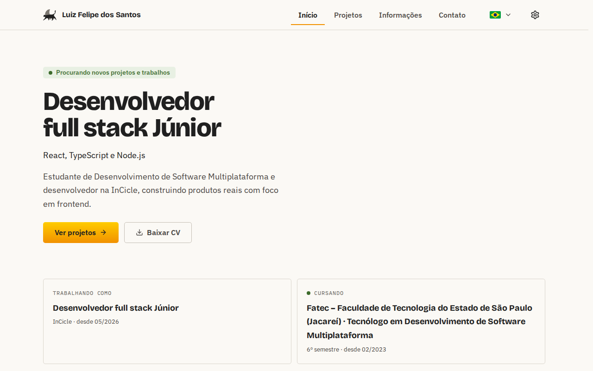

# Portfólio — Luiz Felipe dos Santos

Personal portfolio of Luiz Felipe dos Santos, a full stack developer working with TypeScript.
Five screens in three languages (`pt-BR`, `en` and `es`), with light and dark themes, built with React 19 and Vite.
It runs on local data, with no backend yet: a data layer answers as the future API will.

[](https://github.com/felipe-sant/portfolio-frontend/actions/workflows/ci.yml)
[](https://github.com/felipe-sant/portfolio-frontend/releases)
[](LICENSE)
[](.nvmrc)

**[Ver o site](https://felipe-sant.vercel.app)**

Entrega da Fatec: [site no GitHub Pages](https://fatec-jacarei-dsm-portfolio.github.io/ra2581392423047/pt-BR/) e [repositório da Fatec](https://github.com/fatec-jacarei-dsm-portfolio/ra2581392423047).

<picture>
  <source media="(prefers-color-scheme: dark)" srcset="docs/design/assets/readme/home-dark.png">
  
</picture>

## Como este projeto é feito

Uso o Claude Code como parceiro de desenvolvimento e deixo isso à vista: os commits levam o trailer `Co-Authored-By` e os PRs, a assinatura da ferramenta.

- **Decisão minha:** escopo, prioridade, aprovação de cada spec e o merge.
- **Proposta e implementação da IA:** a spec, o código e os testes, por agentes com papéis separados, descritos em [`.claude/README.md`](.claude/README.md).
- **Antes do merge:** build, lint, testes e E2E no CI; revisão por um agente; em mudança de tela, rodo a aplicação e confiro à mão; e leio cada PR antes de mesclar.

O projeto tem um único autor, então a revisão automática é feita por um agente do mesmo modelo e não há uma segunda pessoa aprovando. O que sustenta a qualidade é eu ler e testar o que a IA gera, e o template de PR pede esse registro.

Um exemplo: três testes E2E falharam porque o corpo de um modal passou a receber o foco do teclado. O agente atualizou os testes para a nova ordem de Tab, e eu conferi que nenhuma asserção foi enfraquecida.

## Sobre o projeto

O portfólio existe para converter visita em contato: mostra o trabalho do autor com profundidade
suficiente para que quem visita entenda como ele resolve problemas, e não apenas quais tecnologias
já usou. O público são recrutadores, clientes avaliando um projeto ou freelance e, na v1, o
professor da Fatec que avalia a entrega.

São cinco telas (Início, Projetos, Projeto, Informações e Contato), a página de erro e a não
encontrada, com tema claro e escuro e interface em `pt-BR` (referência), `en` e `es`. Propósito,
público, escopo e requisitos estão em [`docs/product/overview.md`](docs/product/overview.md).

O formulário da tela Contato é uma demonstração: o envio é simulado, não chega a ninguém. Por isso ele fica desligado (`VITE_CONTACT_FORM_ENABLED`) em todo ambiente publicado até a #44 e o CI barra um build que o contenha. Detalhe em [`docs/screens/contact.md`](docs/screens/contact.md).

## Stack

React 19, TypeScript `strict`, Vite, Redux Toolkit com RTK Query, react-router-dom, i18next, CSS Modules, Vitest com Testing Library e Playwright com axe. O detalhe está em [`docs/architecture/frontend.md`](docs/architecture/frontend.md).

## Como rodar

Com Node.js 24.15 ou superior (o `.nvmrc` fixa a versão do CI) e npm:

```bash
npm install
cp .env.example .env
npm run dev
npm test -- --run
```

O dev server sobe em `http://localhost:5173`. Comandos, build, E2E, CI e git hooks estão em [`docs/setup/development.md`](docs/setup/development.md).

## Por onde começar a ler `docs/`

1. [`docs/README.md`](docs/README.md): o índice de tudo o que existe em `docs/`.
2. [`docs/product/overview.md`](docs/product/overview.md): visão do produto, público, escopo e requisitos.
3. [`docs/architecture/frontend.md`](docs/architecture/frontend.md): camadas, roteamento, estado, estilo e testes.
4. [`docs/adr/README.md`](docs/adr/README.md): as decisões de arquitetura e os ADRs 0001 a 0004.
5. [`docs/setup/environments.md`](docs/setup/environments.md): ambientes, variáveis e publicação.

Para rodar e contribuir, veja [`docs/setup/development.md`](docs/setup/development.md) e o [`CONTRIBUTING.md`](CONTRIBUTING.md) (padrão de branches, commits, PRs e changeset); as regras de código e de agentes estão em [`.claude/CLAUDE.md`](.claude/CLAUDE.md).

## Licença

Distribuído sob a licença MIT, com copyright de Luiz Felipe dos Santos. Ver [`LICENSE`](LICENSE).
