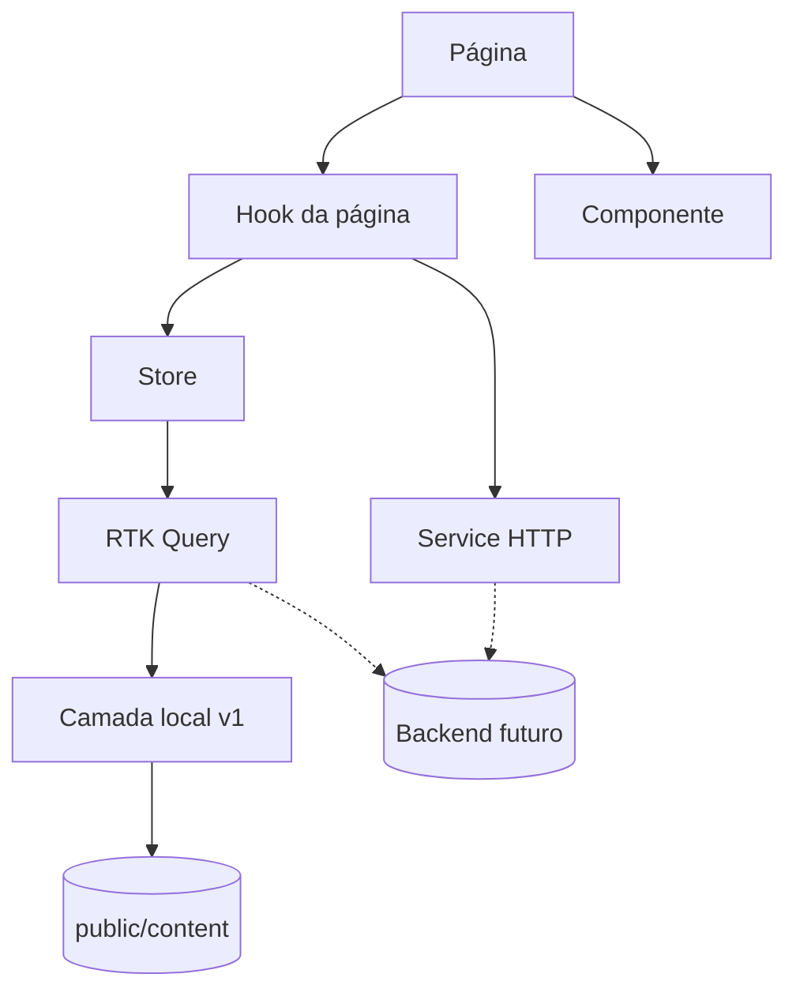
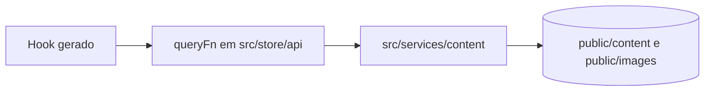

# Arquitetura do frontend

Frontend do portfólio pessoal de Luiz Felipe dos Santos: React 19 e TypeScript, com Vite, Redux Toolkit e RTK Query, i18next, CSS Modules e Vitest. As convenções detalhadas de código ficam no `.claude/CLAUDE.md`; este documento descreve a forma geral da aplicação.

## Camadas

- **Página** (`src/pages/<Nome>.page.tsx`): ligada a uma rota; só chama o hook e renderiza o resultado, com `<title>` e `<meta name="description">` declarados no próprio JSX.
- **Hook da página** (`src/pages/hooks/use<Nome>.ts`): estado, efeitos e acesso a dados ficam fora do JSX. Hooks reutilizáveis entre telas ficam em `src/hooks/`.
- **Componente** (`src/components/`): UI reutilizável, sem rota própria, construída a partir dos componentes do design system do handoff.
- **Layout** (`src/layouts/Main.layout.tsx`): cabeçalho, conteúdo e rodapé comuns às páginas.
- **Store** (`src/store/`): estado compartilhado em slices e estado de servidor em endpoints do RTK Query.
- **Service HTTP** (`src/services/http/`): `get` e `post` sobre `fetch`, para chamadas fora do RTK Query.
- **Camada local** (`src/services/content/`): na v1 não há backend (R1). O conteúdo, em JSON e Markdown sob `public/content/<idioma>/`, é lido só pelos endpoints do RTK Query, cujo `queryFn` chama essa camada, que simula o backend com as mesmas respostas, parâmetros e erros. As entidades estão em [`data-model.md`](data-model.md) e o contrato em [`api-contract.md`](api-contract.md). As pastas `src/pages/hooks/`, `src/hooks/` e `src/components/` nascem no primeiro uso. Ver [Camada de dados local](#camada-de-dados-local-v1).

## Roteamento

Todas as rotas ficam em `src/routers/routes.tsx`, com os paths em `src/routers/paths.ts`. O idioma é o primeiro segmento do caminho (ADR [0002](../adr/0002-language-in-path.md)): `routes.tsx` define as páginas uma vez (`pageRoutes`) e gera três rotas-pai idênticas, `/pt-BR`, `/en` e `/es`, cada uma com `MainLayout`, `errorElement` e um `loader` (`createLanguageLoader`) que troca o idioma do i18next antes do render. As páginas são filhas carregadas sob demanda (`lazy`) e o único `<Suspense>` fica em volta do `<Outlet />` do layout. Fora das três rotas-pai, a rota `/` só redireciona (`redirectRootLoader`: escolha salva, idioma do navegador, `en`) e a rota `*` sem prefixo leva à página não encontrada em inglês, por último. A página de erro é o `errorElement` da rota do layout e renderiza sem ele. O `Router` passa o `base` do Vite como `basename` ao `createBrowserRouter`.

Link interno é montado por `buildPath(path, language, params?)` ou, em componente, por `useLocalizedPath()`, que usa o idioma ativo. `getEquivalentPath(pathname, language)` devolve a URL equivalente em outro idioma, para o seletor.

| Rota                                 | Tela                  | Situação                   |
| ------------------------------------ | --------------------- | -------------------------- |
| `/`                                  | Redireciona           | Existe                     |
| `/<idioma>`                          | Início                | Existe, com o hero mínimo  |
| `/<idioma>/*`, `*`                   | Página não encontrada | Existe                     |
| `/<idioma>/projects`                 | Projetos              | Prevista (D32), sem página |
| `/<idioma>/projects/:id`             | Projeto               | Prevista (D32), sem página |
| `/<idioma>/projects/:id/docs/<name>` | Documentos do projeto | Prevista (D55), sem página |
| `/<idioma>/about`                    | Informações           | Prevista (D32), sem página |
| `/<idioma>/contact`                  | Contato               | Prevista (D32), sem página |

Uma rota só entra em `paths.ts` junto com a página que ela renderiza. Navegação interna usa `<Link>` ou `useNavigate` com o path de `ROUTES`.

## Estado

Hoje a store não tem slice: `src/store/api.ts` declara o `createApi` sem endpoints, os endpoints de conteúdo são injetados por domínio em `src/store/api/` (ver [Camada de dados local](#camada-de-dados-local-v1)) e o `rootReducer` só registra o reducer do RTK Query. A decisão está em [ADR 0001](../adr/0001-state-management.md).

- **Estado de uma tela** fica em `useState` no hook da página. O handoff define o estado de cada tela:

| Tela        | Estado                                                                                          |
| ----------- | ----------------------------------------------------------------------------------------------- |
| Todas       | Tema claro ou escuro; indicador de e-mail copiado no botão de copiar e-mail, que volta em 2,2 s |
| Projetos    | Busca, tipo, categoria, ordenação, filtros ativos, carregando, quantidade visível               |
| Projeto     | Foto atual da galeria, lightbox aberto, arquivo ativo                                           |
| Informações | Item de experiência ou formação aberto                                                          |
| Contato     | Nome, e-mail, mensagem, assunto, erros por campo, tocado, enviando, enviado                     |

- **Estado compartilhado** entre telas vai para um slice em `src/store/slices/`.
- **Dados de conteúdo** (perfil, trajetória, projetos e documentos) vêm de endpoints do RTK Query injetados por domínio em `src/store/api/<dominio>.api.ts`. Na v1, o `queryFn` desses endpoints chama a camada local que simula o backend ([`api-contract.md`](api-contract.md#camada-local-na-v1)), e a #43 troca o `queryFn` pela API mexendo só em `src/store/api/`. O envio do formulário de contato é uma mutation com `queryFn` simulado até a #44.
- **Idioma** continua em `src/i18n/`, fora da store.

## Camada de dados local (v1)

Fluxo de uma leitura: a página chama o hook gerado do endpoint (`projectsApi.useGetProjectsQuery`),
o `queryFn` valida o argumento, a camada local carrega os arquivos de `public/` e monta a resposta
com funções puras, e o resultado volta como `{ data }` ou `{ error }` no formato do contrato.

| Endpoint                                                                  | Contrato                                    |
| ------------------------------------------------------------------------- | ------------------------------------------- |
| `profileApi.useGetProfileQuery({ lang })`                                 | `GET /profile`                              |
| `timelineApi.useGetTimelineQuery({ lang })`                               | `GET /timeline`                             |
| `timelineApi.useGetCurrentTimelineQuery({ lang })`                        | `GET /timeline?current=true`                |
| `projectsApi.useGetProjectsQuery(ProjectListParams)`                      | `GET /projects`                             |
| `projectsApi.useGetProjectQuery({ id, lang })`                            | `GET /projects/{id}`                        |
| `projectsApi.useGetProjectDocumentsQuery({ id, lang })`                   | `GET /projects/{id}/documents`              |
| `projectsApi.useGetProjectDocumentContentQuery({ id, documentId, lang })` | `GET /projects/{id}/documents/{documentId}` |

- **`lang` no argumento:** todo endpoint recebe o idioma explicitamente, como a API vai exigir. O cache do RTK Query é por argumento, então trocar de idioma refaz o pedido sozinho; o `prepareHeaders` de `api.ts` não participa porque o `queryFn` não usa `baseQuery`.
- **Erros:** argumento inválido responde `400` (`UNSUPPORTED_LANGUAGE`, `INVALID_PARAMETER`, `INVALID_ID`), projeto ou documento inexistente responde `404 NOT_FOUND`, ambos com o corpo `ApiError`; arquivo que não carrega vira `FETCH_ERROR`. A mensagem do `ApiError` é texto literal em português, de diagnóstico.
- **Regras só na camada:** busca, filtros, ordenação, paginação, `availableTypes`, destaques, agrupamento e ordem da trajetória, certificados sem repetição e itens em curso vivem em `src/services/content/`; a tela não filtra nem ordena.
- **Caminhos:** todo arquivo de `public/` é pedido com `import.meta.env.BASE_URL`, lido só em `src/utils/publicUrl.ts`. O `src` de imagem do JSON continua relativo, como o contrato, e quem exibe a imagem o resolve com a mesma base.
- **Validação do conteúdo:** `src/services/content/validation/` implementa a seção "Validação do conteúdo" de [`data-model.md`](data-model.md); `npm run content:check` e o teste de `src/services/content/test/content.test.ts` falham com o arquivo, o campo e a regra.

**Trocar pela API (#43):** em `src/store/api/*.api.ts`, cada `queryFn` vira `query` com o mesmo argumento e o mesmo tipo de resposta (`lang` vira parâmetro da URL); remover `src/services/content/` e os dados de `public/content/`; definir `VITE_API_URL`. Nenhuma página, hook de página ou componente muda, porque nenhum deles importa a camada local.

## Estilo

CSS Modules com escopo por arquivo: estilo de página em `src/styles/pages/`, de layout em `src/styles/layouts/` e de componente em `src/styles/components/`. Nenhum valor de cor, tipografia, espaçamento, forma ou movimento é escrito direto no módulo: ele lê os tokens do design system declarados como CSS custom properties em `src/styles/global.css`.

Os nomes dos tokens seguem os `tokens/` do handoff (R3), por exemplo `--brand-primary`, `--bg-page`, `--text-strong`, `--space-4`, `--radius`, `--dur-base` e os semânticos `--success-*`, `--warning-*` e `--danger-*`. Onde o handoff usa classe global `.ds-*`, o repositório usa a classe equivalente no CSS Module do componente.

O tema claro e o escuro existem nos tokens: `:root` guarda o claro e `[data-theme="dark"]` o escuro, ambos com `color-scheme` correspondente. O atributo `data-theme` do `<html>` vem do hook `useTheme` (`src/hooks/useTheme.ts`, chamado em `App.tsx`), que parte do `prefers-color-scheme`, acompanha o sistema enquanto não há escolha e, com `setTheme`/`toggleTheme`, salva a escolha em `localStorage` na chave `portfolio-frontend:theme`, que passa a prevalecer. Um script inline no `<head>` do `index.html` aplica o mesmo `data-theme` e as cores de `theme-color` antes da primeira pintura. As funções de leitura, gravação e aplicação ficam em `src/utils/` (`readStoredTheme`, `saveTheme`, `getSystemTheme`, `applyTheme`). O foco visível é global (`:focus-visible` com `--focus-ring`, que nas faixas `data-surface="band"` vale `--brand-variant`). O alternador de tema na interface vem com o cabeçalho (#33).

As fontes são as três famílias do handoff (Bricolage Grotesque para títulos, IBM Plex Sans para texto e IBM Plex Mono para código e rótulos), self-hospedadas em `public/fonts/` com `@font-face` no `global.css`. O movimento tem escolha própria: `useMotion` (`src/hooks/useMotion.ts`, chamado em `App.tsx`) aplica `data-motion` (`full` ou `reduced`) no `<html>`, parte do `prefers-reduced-motion`, acompanha o sistema enquanto não há escolha e, com `setMotion`/`toggleMotion`, salva a escolha em `localStorage` na chave `portfolio-frontend:motion`, que prevalece. Um script inline do `index.html` o aplica antes da primeira pintura, e `global.css` zera os `--dur-*`, animações e transições em `[data-motion="reduced"]` (e pela media query só enquanto não há `data-motion`). O botão fica no menu de configurações do cabeçalho (#33).

## Internacionalização

Todo texto visível vem de uma chave de tradução, com o valor de cada idioma em `src/locales/<idioma>/<namespace>.json`. Os idiomas suportados são `pt-BR`, `en` e `es`; `pt-BR` é a língua de referência e `en` é o `fallbackLng`.

O caminho da URL decide o idioma (`/pt-BR`, `/en`, `/es`); o i18next inicia com o idioma do primeiro segmento e o `loader` de cada rota-pai o troca na navegação. `?lng=` não tem efeito. A escolha salva por `setLanguage` fica em `localStorage` na chave `portfolio-frontend:language` e só é lida na raiz `/`, que redireciona por ela, depois pelo idioma do navegador e por fim `en`.

Toda feature com texto de UI entrega o texto nos três idiomas, e chave sem uso é removida (R2). O seletor de idioma fica no cabeçalho (`PT · EN · ES`, entre a navegação e o tema) e no menu mobile, e navega para a URL equivalente no outro idioma, salvando a escolha por `setLanguage` (D31, em [`decisions.md`](../design/decisions.md)).

## Testes

- Vitest com Testing Library em `jsdom`; o teste fica em `test/` dentro da pasta do arquivo testado.
- Teste de página e de componente afirma o texto em português; teste que lê a store usa `renderWithStore`.
- Teste de hook com `renderHook` e de função pura sem renderizar interface.
- `npm run test:cov` aplica cobertura mínima de 80% em statements, branches, functions e lines. O CI roda a suíte inteira com cobertura em push e em PR para a `main`, e só os testes afetados nos demais PRs.
