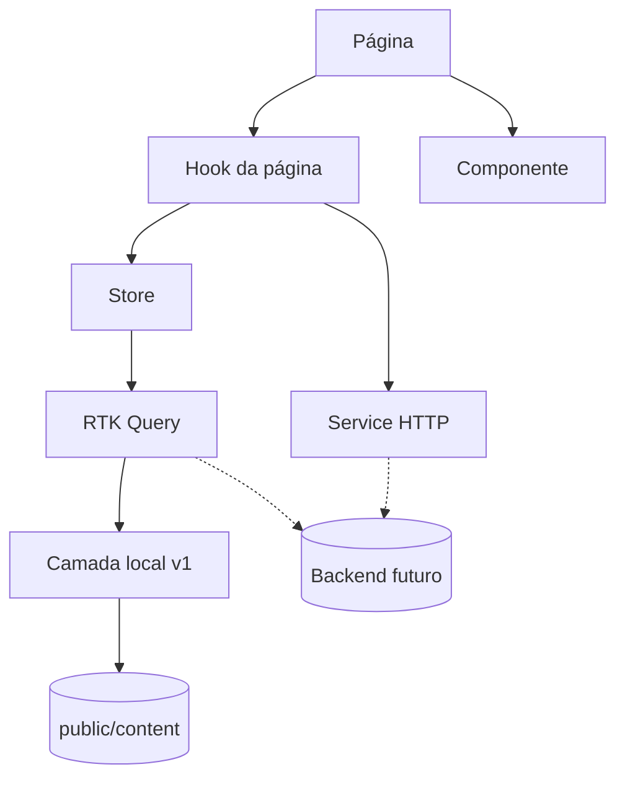
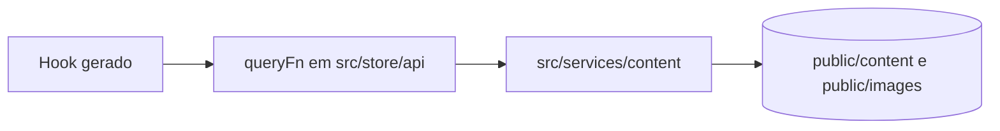

# Arquitetura do frontend

Frontend do portfólio pessoal de Luiz Felipe dos Santos: React 19 e TypeScript, com Vite, Redux Toolkit e RTK Query, i18next, CSS Modules e Vitest. As convenções detalhadas de código ficam no `.claude/CLAUDE.md`; este documento descreve a forma geral da aplicação.

## Camadas

- **Página** (`src/pages/<Nome>.page.tsx`): ligada a uma rota; só chama o hook e renderiza o resultado, com `<title>` e `<meta name="description">` declarados no próprio JSX.
- **Hook da página** (`src/pages/hooks/use<Nome>.ts`): estado, efeitos e acesso a dados ficam fora do JSX. Hooks reutilizáveis entre telas ficam em `src/hooks/`.
- **Componente** (`src/components/`, catálogo em [`components.md`](components.md)): UI reutilizável, sem rota própria, construída a partir dos componentes do design system do handoff.
- **Layout** (`src/layouts/Main.layout.tsx`): cabeçalho, conteúdo e rodapé comuns às páginas.
- **Store** (`src/store/`): estado compartilhado em slices e estado de servidor em endpoints do RTK Query.
- **Service HTTP** (`src/services/http/`): `get` e `post` sobre `fetch`, para chamadas fora do RTK Query.
- **Camada local** (`src/services/content/`): na v1 não há backend (R1). O conteúdo, em JSON e Markdown sob `public/content/<idioma>/`, é lido só pelos endpoints do RTK Query, cujo `queryFn` chama essa camada, que simula o backend com as mesmas respostas, parâmetros e erros. As entidades estão em [`data-model.md`](data-model.md) e o contrato em [`api-contract.md`](api-contract.md). As pastas `src/pages/hooks/`, `src/hooks/` e `src/components/` nascem no primeiro uso. Ver [Camada de dados local](#camada-de-dados-local-v1).

## Roteamento

Todas as rotas ficam em `src/routers/routes.tsx`, com os paths em `src/routers/paths.ts`. O idioma é o primeiro segmento do caminho (ADR [0002](../adr/0002-language-in-path.md)): `routes.tsx` define as páginas uma vez (`pageRoutes`) e gera três rotas-pai idênticas, `/pt-BR`, `/en` e `/es`, cada uma com `MainLayout`, `errorElement` e um `loader` (`createLanguageLoader`) que troca o idioma do i18next antes do render. As páginas são filhas carregadas sob demanda (`lazy`) e o único `<Suspense>` fica em volta do `<Outlet />` do layout. Fora das três rotas-pai, a rota `/` só redireciona (`redirectRootLoader`: escolha salva, idioma do navegador, `en`) e a rota `*` sem prefixo leva à página não encontrada em inglês, por último. A página de erro é o `errorElement` da rota do layout e renderiza sem ele. O `src/prerender/mountClient.tsx`, chamado por `src/entry-client.tsx`, cria o `createBrowserRouter` com o `base` do Vite como `basename`.

Link interno é montado por `buildPath(path, language, params?)` ou, em componente, por `useLocalizedPath()`, que usa o idioma ativo. `getEquivalentPath(pathname, language)` devolve a URL equivalente em outro idioma, para o seletor.

| Rota                                 | Tela                  | Situação     |
| ------------------------------------ | --------------------- | ------------ |
| `/`                                  | Redireciona           | Existe       |
| `/<idioma>`                          | Início                | Existe       |
| `/<idioma>/*`, `*`                   | Página não encontrada | Existe       |
| `/<idioma>/projects`                 | Projetos              | Existe       |
| `/<idioma>/projects/:id`             | Projeto               | Existe (D32) |
| `/<idioma>/projects/:id/docs/<name>` | Documentos do projeto | Existe (D55) |
| `/<idioma>/about`                    | Informações           | Existe (D32) |
| `/<idioma>/contact`                  | Contato               | Existe       |

Uma rota só entra em `paths.ts` junto com a página que ela renderiza. Navegação interna usa `<Link>` ou `useNavigate` com o path de `ROUTES`.

## Pré-renderização

Decidida no [ADR 0004](../adr/0004-prerendering.md) (opção 1, script próprio, sem biblioteca nova). `npm run build` gera, em `dist/`, um HTML por rota pública pré-renderizada e por idioma, mais o `404.html`, e o cliente os hidrata sem erro.

- **Entrada de servidor** (`src/entry-server.tsx`, `render(target)`): `createStaticHandler`, `createStaticRouter` e `StaticRouterProvider` sobre `routes`, com uma store nova por chamada; carrega os dados da rota (`src/prerender/loadPrerenderData.ts`: o perfil do Rodapé mais as consultas da rota, por `initiate`, aguardando as assinaturas e dando `unsubscribe` ao fim, falhando o build com a rota e a causa se uma consulta der erro) e renderiza com `prerender` de `react-dom/static` e `progressiveChunkSize: Infinity`, para nenhum bloco de Suspense sair fora de linha. Os renders são sequenciais, porque o i18next é uma instância global trocada pelo `loader` de cada rota.
- **Registro** (`src/prerender/prerenderRoutes.ts`): descreve cada rota pré-renderizável (padrão, escopo dos parâmetros e consultas). A raiz `/` nunca entra (responde 302). `scripts/prerender/listTargets.ts` só emite o alvo cujo padrão existe em `routes` além da `*`; o resto é listado como ignorado e não falha o build. **Toda tela nova entrega a própria pré-renderização**: acrescenta a entrada ao registro (rota e consultas) e um teste de `<h1>` e conteúdo principal nos três idiomas.
- **Arquivos** (todos sob o `base`): `pt-BR.html`, `en.html`, `es.html` para a Início; `<idioma>/<rota>.html` para as demais; `<idioma>/projects/<id>.html`; documento em `<idioma>/projects/<id>/docs/<nome>.html` com o nome do arquivo e a extensão (`SETUP.md.html`), **nunca** em pasta com `index.html`, que o Pages redireciona (301) e quebra a URL do D55. O `README.md` do projeto é `/projects/<id>` e não gera arquivo de documento. O `404.html` é a página não encontrada em inglês; `/` continua o `index.html`, com o script de redirecionamento por idioma.
- **Composição** (`scripts/prerender/composePage.ts`): parte do `index.html` buildado, troca o `lang`, move o `<head>` que o React emite (`title`, `meta`, `link`, `script type="application/ld+json"`) para o `<head>` do arquivo sem duplicar `title` nem `description`, acrescenta ao `<head>` o `<link rel="stylesheet">` dos CSS de chunk que a rota usa (`readStylesheets` lê `dist/assets/*.css`; `selectStylesheets` escolhe os que têm classe presente no HTML da rota e que o `index.html` ainda não linka), troca o `<noscript>` pelo texto de `common:noscript` do idioma (a faixa de aviso, em vermelho claro, é `body > noscript` em `global.css`, sob `@media (scripting: none)`), põe o corpo em `#root` e grava `window.prerenderedPath`, `window.preloadedState` e `window.routerData`, com `<` escapado como `\u003c`. Falha se o HTML tiver `id="S:`.
- **Leitura de `public/` no Node** (`scripts/prerender/installPublicFetch.ts`): durante a pré-renderização troca `globalThis.fetch` por uma leitura de `public/` para URLs sob o `base`, restaurando no fim; `src/services/` não muda.
- **Cliente** (`src/entry-client.tsx` e `src/prerender/mountClient.tsx`): `hydrateRoot` com `preloadedState` e `hydrationData` quando `shouldHydrate` vê que o caminho aberto é o `prerenderedPath`; senão remove o `title` e a `meta description` do HTML (`removePrerenderedHead`) e usa `createRoot` sem estado nem dados do roteador. É o caso do `404.html` servido em `/pt-BR/xyz` e da raiz `/`.
- **Guarda de ambiente**: `src/i18n/i18n.ts` testa `typeof window` e `typeof document` para importar no Node.
- **Teste**: `src/test/entry-server.test.tsx` renderiza cada rota do registro existente nos três idiomas; a hidratação (`src/prerender/test/mountClient.test.tsx`) usa HTML gerado por `src/testUtils/prerenderGlobalSetup.ts`, que roda no processo principal do Vitest, porque o `react-dom/server` deixa os contextos do React sujos no mesmo processo e o cliente acusaria "multiple renderers".

## Metadados de SEO

Cada tela pública declara, além de `<title>` e `<meta name="description">`, o mecanismo de #52: `<PageMeta title description path params? type? image? />` (`src/components/PageMeta.tsx`) emite `<link rel="canonical">` autorreferente, quatro `<link rel="alternate" hreflang>` (`pt-BR`, `en`, `es` e `x-default` para `en`), Open Graph (`og:title`, `og:description`, `og:type`, `og:url`, `og:image` com 1200×630 e `og:image:alt`, `og:locale` e `og:locale:alternate`) e `twitter:card` `summary_large_image`; `<JsonLd data={...} />` (`src/components/JsonLd.tsx`) emite o `<script type="application/ld+json">`, serializado por `serializeJsonLd` com todo `<` escapado como `\u003c` (NF-IA-09). As duas usam as tags nativas do React 19, sem biblioteca, e acompanham a troca de idioma sem recarregar. Query e hash nunca entram nas URLs. A canônica de `/projects` não leva a query (D45).

A URL absoluta vem de `buildAbsoluteUrl(path, language, params?)` (`src/utils/`): `getSiteUrl()` (única leitura de `VITE_SITE_URL`, só a origem) mais o `base` do Vite (`publicUrl`, uma vez só) mais o caminho com prefixo de idioma (`buildPath`). `VITE_SITE_URL` é validada no `npm run build` por `scripts/resolveSiteUrl.ts` e vale em canônica, Open Graph e sitemap (NF-HO-06); valores por ambiente em [`environments.md`](../setup/environments.md#variáveis). A imagem padrão `public/images/og-site.png` (gato e nome) é gerada por `npm run og:image` e versionada. Os dados do JSON-LD de cada tela vêm de construtores em `src/utils/` (`buildHomeJsonLd`, `buildProjectsJsonLd`), com o `@id` único da `Person` em `<URL canônica de />#person`. No HTML pré-renderizado o `<link>` e o `<meta>` sobem para o `<head>`; o `<script>` do JSON-LD fica no corpo, o que o Google aceita. A não encontrada e a de erro não usam o mecanismo (`noindex`).

## Arquivos para buscadores e IA

`npm run build` termina com `npm run build:seo` (`scripts/generateSeoFiles.ts`), que escreve na raiz de `dist/`, sob o `base` do Vite, seis arquivos de texto (#51): `robots.txt` (grupo `*` e um grupo liberado para cada um dos 11 crawlers de IA de NF-IA-12, com o `Sitemap:` absoluto), `sitemap.xml` (uma `<url>` por rota pré-renderizada e idioma, com `xhtml:link` para `pt-BR`, `en`, `es` e `x-default` em `en`, e `<lastmod>` só quando o projeto ou o documento tem `updatedAt`), `llms.txt` (formato de llmstxt.org, em `pt-BR`, com as quatro páginas nos três idiomas, cada projeto uma vez com os links `en` e `es`, o CV em Markdown e PDF e os três textos completos) e `llms-full.txt`, `llms-full.en.txt` e `llms-full.es.txt` (perfil, stack, trajetória completa, CV embutido e, por projeto, ficha técnica, links, galeria e os documentos Markdown, sem o `LICENSE`).

- **Fonte**: os JSONs de `public/content/`, os `cv-<idioma>.md` e `.pdf` de `public/cv/` e os rótulos de `src/locales/<idioma>/common.json`, lidos por `scripts/seo/readSeoContent.ts`; as rotas vêm de `listTargets` (#49) sobre o `dist-server/`, a mesma lista da pré-renderização, então o sitemap só tem o que foi pré-renderizado (sem a raiz `/` nem o `404.html`).
- **URLs**: `scripts/seo/buildSeoUrl.ts` monta origem + `base` + caminho, iguais às canônicas de `buildAbsoluteUrl`; a origem vem de `VITE_SITE_URL` (`scripts/seo/resolveSeoOrigin.ts`) e o subcaminho de `BASE_PATH`.
- **Código**: um gerador puro por arquivo em `scripts/seo/` (`buildRobotsTxt`, `buildSitemapXml`, `buildLlmsTxt`, `buildLlmsFullTxt`); `writeSeoFiles` gera tudo em memória antes de escrever, então JSON inválido ou arquivo ausente falha o build em português, sem arquivo parcial.
- **Como conferir**: depois de `npm run build:fatec` e `npm run preview:fatec`, `curl -s http://localhost:4173/ra2581392423047/robots.txt` (e `sitemap.xml`, `llms.txt`, `llms-full.txt`, `llms-full.en.txt`, `llms-full.es.txt`) devolve 200. No Pages da Fatec o `robots.txt` do subcaminho não é lido por crawlers (NF-IA-13), mas é gerado mesmo assim. A `staging` recebe os mesmos arquivos, com o `noindex` do `deploy.yml`.

## Estado

Hoje a store não tem slice: `src/store/api.ts` declara o `createApi` sem endpoints, os endpoints de conteúdo são injetados por domínio em `src/store/api/` (ver [Camada de dados local](#camada-de-dados-local-v1)) e o `rootReducer` só registra o reducer do RTK Query. A decisão está em [ADR 0001](../adr/0001-state-management.md).

- **Estado de uma tela** fica em `useState` no hook da página. O handoff define o estado de cada tela:

| Tela        | Estado                                                                                          |
| ----------- | ----------------------------------------------------------------------------------------------- |
| Todas       | Tema claro ou escuro; indicador de e-mail copiado no botão de copiar e-mail, que volta em 2,2 s |
| Projetos    | Busca, tipo, categoria, ordenação, filtros ativos, carregando, quantidade visível               |
| Projeto     | Foto atual da galeria, lightbox aberto, arquivo ativo                                           |
| Informações | Item de experiência ou formação aberto                                                          |
| Contato     | Nome, e-mail, mensagem, assunto, erros por campo, tocado, enviando, enviado                     |

- **Estado compartilhado** entre telas vai para um slice em `src/store/slices/`.
- **Dados de conteúdo** (perfil, trajetória, projetos e documentos) vêm de endpoints do RTK Query injetados por domínio em `src/store/api/<dominio>.api.ts`. Na v1, o `queryFn` desses endpoints chama a camada local que simula o backend ([`api-contract.md`](api-contract.md#camada-local-na-v1)), e a #43 troca o `queryFn` pela API mexendo só em `src/store/api/`. O envio do formulário de contato é uma mutation com `queryFn` simulado até a #44.
- **Idioma** continua em `src/i18n/`, fora da store.

## Camada de dados local (v1)

Fluxo de uma leitura: a página chama o hook gerado do endpoint (`projectsApi.useGetProjectsQuery`),
o `queryFn` valida o argumento, a camada local carrega os arquivos de `public/` e monta a resposta
com funções puras, e o resultado volta como `{ data }` ou `{ error }` no formato do contrato.

| Endpoint                                                                  | Contrato                                    |
| ------------------------------------------------------------------------- | ------------------------------------------- |
| `profileApi.useGetProfileQuery({ lang })`                                 | `GET /profile`                              |
| `timelineApi.useGetTimelineQuery({ lang })`                               | `GET /timeline`                             |
| `timelineApi.useGetCurrentTimelineQuery({ lang })`                        | `GET /timeline?current=true`                |
| `projectsApi.useGetProjectsQuery(ProjectListParams)`                      | `GET /projects`                             |
| `projectsApi.useGetProjectsPagesInfiniteQuery(args)`                      | `GET /projects` por páginas de 9            |
| `projectsApi.useGetProjectFilterOptionsQuery({ lang })`                   | `GET /projects/filter-options`              |
| `projectsApi.useGetProjectQuery({ id, lang })`                            | `GET /projects/{id}`                        |
| `projectsApi.useGetProjectDocumentsQuery({ id, lang })`                   | `GET /projects/{id}/documents`              |
| `projectsApi.useGetProjectDocumentContentQuery({ id, documentId, lang })` | `GET /projects/{id}/documents/{documentId}` |

- **`lang` no argumento:** todo endpoint recebe o idioma explicitamente, como a API vai exigir. O cache do RTK Query é por argumento, então trocar de idioma refaz o pedido sozinho; o `prepareHeaders` de `api.ts` não participa porque o `queryFn` não usa `baseQuery`.
- **Erros:** argumento inválido responde `400` (`UNSUPPORTED_LANGUAGE`, `INVALID_PARAMETER`, `INVALID_ID`), projeto ou documento inexistente responde `404 NOT_FOUND`, ambos com o corpo `ApiError`; arquivo que não carrega vira `FETCH_ERROR`. A mensagem do `ApiError` é texto literal em português, de diagnóstico.
- **Regras só na camada:** busca, filtros, ordenação, paginação, `availableTypes`, as opções de filtro com contagem (`ProjectFilterOptions`), destaques, agrupamento e ordem da trajetória, certificados sem repetição e itens em curso vivem em `src/services/content/`; a tela não filtra nem ordena.
- **Caminhos:** todo arquivo de `public/` é pedido com `import.meta.env.BASE_URL`, lido só em `src/utils/publicUrl.ts`. O `src` de imagem do JSON continua relativo, como o contrato, e quem exibe a imagem o resolve com a mesma base.
- **Validação do conteúdo:** `src/services/content/validation/` implementa a seção "Validação do conteúdo" de [`data-model.md`](data-model.md); `npm run content:check` e o teste de `src/services/content/test/content.test.ts` falham com o arquivo, o campo e a regra.

- **Cache de leitura (D65):** `readText` (`src/services/content/`) guarda a promessa por caminho, de modo que `projects.json` e `profile.json` são lidos uma vez por carga, e não uma vez por consulta; leitura que falha apaga a entrada. A tela de Projetos abre duas consultas (lista e opções do modal), e o `ItemList` do JSON-LD sai da primeira página da lista, sem consulta própria. Tudo isso é da camada local e sai com ela na #43.
- **Migração (#43): a filtragem sai do frontend.** Busca, filtros por tipo, categoria, tecnologia e ano, ordenação, paginação, `availableTypes` e as opções do modal com contagem são simulados em `src/services/content/` só para a v1. Quando a #43 trocar cada `queryFn` por `query`, essas regras saem do frontend e o servidor passa a receber `q`, `type`, `category`, `tech`, `year`, `sort`, `offset` e `limit`; a tela só monta parâmetros e acumula páginas. Detalhe em [`api-contract.md`](api-contract.md#camada-local-na-v1).

**Trocar pela API (#43):** em `src/store/api/*.api.ts`, cada `queryFn` vira `query` com o mesmo argumento e o mesmo tipo de resposta (`lang` vira parâmetro da URL); remover `src/services/content/` e os dados de `public/content/`; definir `VITE_API_URL`. Nenhuma página, hook de página ou componente muda, porque nenhum deles importa a camada local.

## Estilo

CSS Modules com escopo por arquivo: estilo de página em `src/styles/pages/`, de layout em `src/styles/layouts/` e de componente em `src/styles/components/`. Nenhum valor de cor, tipografia, espaçamento, forma ou movimento é escrito direto no módulo: ele lê os tokens do design system declarados como CSS custom properties em `src/styles/global.css`.

Os nomes dos tokens seguem os `tokens/` do handoff (R3), por exemplo `--brand-primary`, `--bg-page`, `--text-strong`, `--space-4`, `--radius`, `--dur-base` e os semânticos `--success-*`, `--warning-*` e `--danger-*`. Onde o handoff usa classe global `.ds-*`, o repositório usa a classe equivalente no CSS Module do componente.

O tema claro e o escuro existem nos tokens: `:root` guarda o claro e `[data-theme="dark"]` o escuro, ambos com `color-scheme` correspondente. O atributo `data-theme` do `<html>` vem do hook `useTheme` (`src/hooks/useTheme.ts`, chamado em `App.tsx`), que parte do `prefers-color-scheme`, acompanha o sistema enquanto não há escolha e, com `setTheme`/`toggleTheme`, salva a escolha em `localStorage` na chave `portfolio-frontend:theme`, que passa a prevalecer. Um script inline no `<head>` do `index.html` aplica o mesmo `data-theme` e as cores de `theme-color` antes da primeira pintura. As funções de leitura, gravação e aplicação ficam em `src/utils/` (`readStoredTheme`, `saveTheme`, `getSystemTheme`, `applyTheme`). O foco visível é global (`:focus-visible` com `--focus-ring`, que nas faixas `data-surface="band"` vale `--brand-variant`). O alternador de tema na interface vem com o cabeçalho (#33).

As fontes são as três famílias do handoff (Bricolage Grotesque para títulos, IBM Plex Sans para texto e IBM Plex Mono para código e rótulos), self-hospedadas em `public/fonts/` com `@font-face` no `global.css`. O movimento tem escolha própria: `useMotion` (`src/hooks/useMotion.ts`, chamado em `App.tsx`) aplica `data-motion` (`full` ou `reduced`) no `<html>`, parte do `prefers-reduced-motion`, acompanha o sistema enquanto não há escolha e, com `setMotion`/`toggleMotion`, salva a escolha em `localStorage` na chave `portfolio-frontend:motion`, que prevalece. Um script inline do `index.html` o aplica antes da primeira pintura, e `global.css` zera os `--dur-*`, animações e transições em `[data-motion="reduced"]` (e pela media query só enquanto não há `data-motion`). O botão fica no menu de configurações do cabeçalho (#33).

## Internacionalização

Todo texto visível vem de uma chave de tradução, com o valor de cada idioma em `src/locales/<idioma>/<namespace>.json`. Os idiomas suportados são `pt-BR`, `en` e `es`; `pt-BR` é a língua de referência e `en` é o `fallbackLng`.

O caminho da URL decide o idioma (`/pt-BR`, `/en`, `/es`); o i18next inicia com o idioma do primeiro segmento e o `loader` de cada rota-pai o troca na navegação. `?lng=` não tem efeito. A escolha salva por `setLanguage` fica em `localStorage` na chave `portfolio-frontend:language` e só é lida na raiz `/`, que redireciona por ela, depois pelo idioma do navegador e por fim `en`.

Toda feature com texto de UI entrega o texto nos três idiomas, e chave sem uso é removida (R2). O seletor de idioma fica no cabeçalho (`PT · EN · ES`, entre a navegação e o tema) e no menu mobile, e navega para a URL equivalente no outro idioma, salvando a escolha por `setLanguage` (D31, em [`decisions.md`](../design/decisions.md)).

## Testes

- Convenção e mecânica completas em [`testing.md`](../setup/testing.md).
- Vitest com Testing Library em `jsdom`; o teste fica em `test/` dentro da pasta do arquivo testado.
- Teste de página e de componente afirma o texto em português; teste que lê a store usa `renderWithStore`.
- Teste de hook com `renderHook` e de função pura sem renderizar interface.
- `npm run test:cov` aplica cobertura mínima de 80% em statements, branches, functions e lines. O CI roda a suíte inteira com cobertura em push, e só os testes afetados nos PRs para a `staging`.

## Detalhe de implementação

Texto movido do `.claude/CLAUDE.md`, por área. As seções acima dão a visão geral; aqui está o mecanismo.

### Estilos e tokens

- **`src/styles/`** — `global.css` guarda as CSS custom properties (cor, tipografia, espaçamento e
  afins) e o reset. CSS Module usa essas custom properties em vez de valor hardcoded; confira os
  nomes em `src/styles/global.css` antes de usar, e token global novo entra lá. Os nomes dos
  tokens seguem os de `tokens/` do handoff de design (ex.: `--danger-surface`/`--danger-ink`,
  nunca um prefixo próprio como `error`). Estilos de página ficam em
  `src/styles/pages/<nome>.module.css` e de componente em
  `src/styles/components/<nome>.module.css` (CSS Modules), importados como `import css from "..."`.
  A tipagem dos módulos vem de `src/types/declarations.d.ts` (`{ [key: string]: string }`): toda
  classe usada como `css.<algo>` precisa existir no módulo importado, porque uma classe inexistente
  vira `undefined` em runtime, sem erro de compilação.

### Tema

- **Tema (claro/escuro)** — `[data-theme="dark"]` em `global.css` (o claro é `:root`), com
  `color-scheme`. `useTheme()` de `src/hooks/useTheme.ts` (`{ theme, setTheme, toggleTheme }`) é
  chamado em `App.tsx` e é a única via de escrita da escolha (`saveTheme`, chave
  `portfolio-frontend:theme` em `themeStorageKey.ts`); leitura, sistema e aplicação ficam em
  `src/utils/` (`readStoredTheme`, `getSystemTheme`, `applyTheme`). Um segundo script inline do
  `index.html` aplica `data-theme` e `theme-color` antes da pintura (chave e cores duplicadas;
  `themeScript.test.ts` compara com os utilitários). `?tema=` não existe. Foco é global
  (`:focus-visible` com `--focus-ring`; faixa escura usa `data-surface="band"`), e `a` em
  `global.css` é sublinhado: componente que se apresenta como botão zera no próprio módulo.

### Movimento

- **Movimento** — `useMotion()` de `src/hooks/useMotion.ts` (`{ motion, setMotion, toggleMotion }`,
  `full` ou `reduced`) espelha o tema: chamado em `App.tsx`, única via de escrita da escolha
  (`saveMotion`, chave `portfolio-frontend:motion` em `motionStorageKey.ts`), leitura, sistema e
  aplicação em `src/utils/` (`readStoredMotion`, `getSystemMotion`, `applyMotion`). A escolha vale
  mais que `prefers-reduced-motion`; sem ela, o sistema decide. `global.css` zera os `--dur-*`,
  animações e transições com `[data-motion="reduced"]` (e pela media query só enquanto não há
  `data-motion`); um terceiro script inline do `index.html` aplica `data-motion` antes da pintura
  (chave duplicada; `motionScript.test.ts` compara com os utilitários). Animação nova usa
  `--dur-*` e `--ease`, nunca duração fixa, para o botão e o sistema a desligarem. Movimentos
  extras (D57 a D60): `usePageTransition()` (`src/hooks/`, `true` só com movimento pleno) alimenta a
  prop `viewTransition` dos `Link` de navegação (o `LanguageSelector` fica sem); `startThemeTransition`
  (`src/utils/`, chamada por `useTheme.setTheme`) liga `data-theme-transition` no `<html>` durante a
  troca; `useReveal()` (`src/hooks/`, devolve `ref` e `revealProps`) e o componente `SkeletonSwap`
  são usados pela Início (destaques, cabeçalho da seção e botões finais pelo componente `Reveal`, e skeletons dos blocos), com `useReveal` escondendo só o que está abaixo da primeira tela depois da hidratação (o HTML pré-renderizado sai visível); Projetos usa `useReveal` nos cards (`ProjectCard`, por `revealIndex`) e `SkeletonSwap` na grade; `useDragScroll` (arrastar com o mouse região rolável), `useMediaQuery` (consulta de mídia por `useSyncExternalStore`), `useDebounce` e `useHasHydrated` (`false` só durante a hidratação, por `useSyncExternalStore`) completam `src/hooks/`; tokens `--dur-page`,
  `--stagger` e `--press-scale` são neutralizados nos dois blocos de movimento reduzido. O hover de `projectCard.module.css` e `featuredProject.module.css` zera o deslocamento com movimento reduzido por `:global(:root[data-motion="reduced"])` (dentro de `@media (hover: hover)`, sem depender do media de movimento reduzido) e por `:global(:root:not([data-motion]))` (dentro de `@media (hover: hover) and (prefers-reduced-motion: reduce)`), espelhando a lógica do `global.css`; é o único uso de `:global` em CSS Module do projeto, e não usa token como `--hover-lift` porque o `transform` computado precisa ser `none`.
