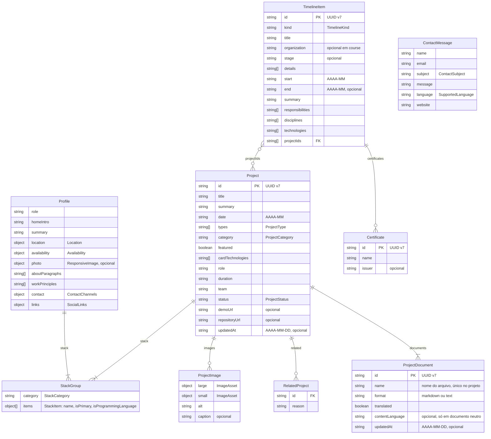

# Entidades

O diagrama abaixo mostra as entidades de conteúdo do portfólio na forma **guardada no conteúdo**,
isto é, o registro como ele é salvo, e não a resposta que a API monta a partir dele. Campos, tipos,
formatos e regras vêm de [`../architecture/data-model.md`](../architecture/data-model.md), que é a
fonte; os nomes do handoff de design, em português, estão mapeados em
[Mapeamento do handoff](../architecture/data-model.md#mapeamento-do-handoff).

Na v1 não há backend (R1): os dados são o conteúdo real, em JSON local, servidos por uma camada
local que simula o backend, com as mesmas respostas, parâmetros e erros
([`../architecture/api-contract.md`](../architecture/api-contract.md)).

Observações sobre o diagrama:

- `end` ausente em `TimelineItem` indica período em curso.
- `TimelineItem.projectIds` referencia projetos pelo `id`; na resposta, a API troca esse campo por
  `projects: { id, title }[]`, com o título no idioma pedido.
- `Project.related` é guardado como `{ id, reason }` e devolvido expandido, com o resumo do projeto
  relacionado.
- `technologies` e `cover` do projeto são montados pela API a partir de `stack` e `images`, por
  isso não aparecem na forma guardada.
- `Project` é a forma guardada de `ProjectDetail`. As respostas montadas pela API (`ProjectPage`,
  `Timeline`, `TimelineGroup` e `CurrentTimeline`) não estão no diagrama.
- `ProjectDocument` descreve cada documento do projeto (D55); o conteúdo do arquivo fica fora do
  registro, um por idioma quando o documento é traduzido e um só quando é neutro.
- `ContactMessage` é o corpo do envio de contato, não um registro do conteúdo.
- O CV é um arquivo próprio por idioma, fora do modelo (D52).

