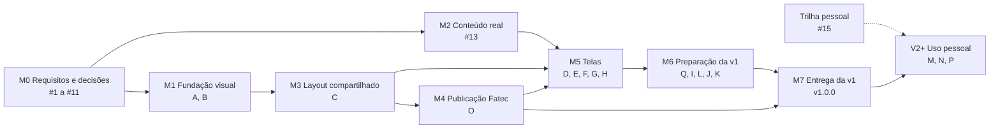

# Roadmap

Este documento diz em que ordem as entregas do portfólio acontecem e o que define cada versão. Não é cronograma nem quadro de status: datas e andamento vivem nas issues do GitHub e no `**Status:**` de cada spec. O produto tem duas fases: a **v1** é a entrega da faculdade (Fatec) e as versões **V2+** são de uso pessoal. As issues que ainda não existem aparecem por letra e descrição (A a Q) e serão criadas depois que a documentação (#1 a #11) terminar; ao criar uma delas, a letra vira o número neste documento. Mudar a ordem dos marcos ou o escopo de uma versão é decisão do PO e muda este documento no mesmo PR. Os requisitos R1 a R3 estão em [`overview.md`](overview.md) e as decisões de design (`Dnn`, `PIn`) em [`decisions.md`](../design/decisions.md).

## Versões

| Versão | Para quê                     | Onde roda                                                                                       | Dados                                          | Backend |
| ------ | ---------------------------- | ----------------------------------------------------------------------------------------------- | ---------------------------------------------- | ------- |
| v1     | Entrega da faculdade (Fatec) | GitHub Pages de `fatec-jacarei-dsm-portfolio/ra2581392423047`, subcaminho `/ra2581392423047/`   | Reais, em JSON local, pelo caminho da API (R1) | Não     |
| V2+    | Uso pessoal                  | Vercel (`staging` = testes, `main` = produção), depois AWS com backend e banco na mesma máquina | Do backend, quando existir                     | Sim     |

A Vercel (#15) pode existir antes da v1 como ambiente pessoal, mas não é requisito dela.

**Destino por versão:** a linha 1.x (de `v1.0.0` até antes de `v2.0.0`) é a única publicada no repositório da Fatec. A partir de `v2.0.0` o destino é só o deploy pessoal (Vercel, depois AWS), e a Action de publicação da Fatec fica inerte (ver M4).

## Versionamento

A partir da v1, o projeto usa SemVer com versão automática por Changesets (issue Q), no modelo do repositório `ai-core` do PO, adaptado a uma aplicação que não publica pacote.

- **Antes da v1, sem tags.** O `version` do `package.json` fica em `0.1.0` até a entrega.
- **Cada release é uma tag `vX.Y.Z` na `main`**, com GitHub Release e a seção correspondente do `CHANGELOG.md`, gerado pelo Changesets.
- **Regra de incremento:** `major` quando muda o público ou a forma de publicar (`v1.0.0` = entrega da Fatec; `v2.0.0` = uso pessoal com backend); `minor` para tela ou funcionalidade nova; `patch` para correção e ajuste de conteúdo. Hotfix gera `patch`.
- **Cada PR de trabalho traz um changeset** (`.changeset/*.md` com o tipo e uma nota em português), ou um changeset vazio (`changeset --empty`) quando não muda versão, como em documentação. Uma checagem de CI configurada na Q garante isso.
- **Fluxo:** o changeset entra no PR para a `staging`. Um push na `staging` com changesets pendentes faz a Action abrir ou atualizar o PR de versão (`changeset-release/staging` → `staging`), que sobe o `version` e escreve o `CHANGELOG.md`. A promoção `staging` → `main` leva a versão nova. Um push na `main` com versão `>= 1.0.0` ainda sem tag cria a tag `vX.Y.Z` e o Release e, se a versão for 1.x, chama a publicação da Fatec (O).
- **Chegada à `1.0.0`:** o PR que marca a entrega traz um changeset `major`; o PR de versão gera `1.0.0` (a partir de `0.1.0`) e a promoção cria a tag `v1.0.0`, sem tag manual. Entre a configuração da Q e esse PR, todo changeset é vazio, para nenhuma versão `0.x` ser gerada.

## Ponto de partida: a ordem do handoff

A ordem sugerida pelo handoff, citada na #11: (1) tokens e tema com `data-theme`; (2) primitivos; (3) cabeçalho e rodapé; (4) Início; (5) Projetos; (6) Projeto; (7) Informações e Contato; (8) menu mobile. O roadmap muda essa ordem nestes pontos:

- A documentação de requisitos e decisões (#1 a #11) vem antes da implementação, e as issues de implementação só nascem depois dela.
- O menu mobile entra no layout, porque D01 já decidiu o painel.
- O conteúdo real (#13) é marco próprio, em paralelo à fundação visual, e depende de material do PO além do modelo de dados (#10).
- Informações e Contato viram duas entregas: Contato carrega o formulário desligado (D05).
- A publicação no GitHub Pages do repositório da v1 (O) é configurada cedo, logo depois do layout, em modo de ensaio, para as telas já nascerem funcionando sob o subcaminho. A primeira publicação real é a `v1.0.0`.

## Marcos

| Marco                     | Entrega                                                                                                                                                                                                                    | Depende de                                                       | Issues                                                     | Bloqueio                                   |
| ------------------------- | -------------------------------------------------------------------------------------------------------------------------------------------------------------------------------------------------------------------------- | ---------------------------------------------------------------- | ---------------------------------------------------------- | ------------------------------------------ |
| M0 Requisitos e decisões  | Roadmap; visão; requisitos não funcionais e de acessibilidade; layout e cinco telas; modelo de dados e contrato. Ao fim, criação das issues A a Q                                                                          | Nada                                                             | #11, #1, #8, #9, #2, #3, #4, #5, #6, #7, #10 (nesta ordem) | Nenhum                                     |
| M1 Fundação visual        | A: tokens do protótipo, tema por `data-theme`, foco visível. B: componentes base e ícones                                                                                                                                  | #2, #8, #9                                                       | A, B (a criar)                                             | Nenhum                                     |
| M2 Conteúdo real          | JSONs com o conteúdo real do PO (projetos, trajetória, perfil, stack, certificados, canais) em `pt-BR`, traduzido para `en` e `es` no projeto, servido pela camada local no formato do contrato                            | #10 e o conteúdo entregue pelo PO                                | #13                                                        | Material do PO (conteúdo)                  |
| M3 Layout compartilhado   | C: cabeçalho com logo, navegação, idioma e tema; menu mobile; rodapé e variante de Contato; 404 e erro; metadados                                                                                                          | #2, A, B                                                         | C (a criar)                                                | Nenhum (D01 e D02 decididos)               |
| M4 Publicação Fatec       | O: build com `base` `/ra2581392423047/`, `basename` no router, `404.html`, `.nojekyll` e workflow que faz commit do `dist/` em `main:/docs` do repositório da v1                                                           | C; token do PO nos Secrets deste repositório                     | O (a criar)                                                | Credencial (token aceito pela organização) |
| M5 Telas                  | D Início → E Projetos → F Projeto → G Informações → H Contato, com estados, dois temas e três idiomas                                                                                                                      | Cada tela: o próprio documento (#3 a #7), #13, C e O; F também E | D, E, F, G, H (a criar)                                    | Nenhum para implementar                    |
| M6 Preparação da v1       | Q: versionamento por Changesets, tag e Release. I: CV em PDF nos três idiomas. L: capturas reais e foto (D26). J: poda de pesos de fonte. K: verificação de acessibilidade, responsividade e performance no build do Pages | M5; I e L também dependem de material do PO                      | Q, I, J, K, L (a criar)                                    | Material do PO (PDFs e imagens)            |
| M7 Entrega da v1          | PR com changeset `major`, PR de versão (`1.0.0`), promoção `staging` → `main`, tag `v1.0.0` e Release criados pela Action, publicação no GitHub Pages do repositório da v1 e URL entregue ao professor                     | M6, O e Q                                                        | Nenhuma (PR de promoção e release)                         | Herda os de M6                             |
| Trilha pessoal (paralela) | Deploy na Vercel: `staging` em testes, `main` em produção pessoal                                                                                                                                                          | Nada além do PO configurar a conta                               | #15                                                        | Nenhum; não é requisito da v1              |
| V2+ Uso pessoal           | Backend; troca da fonte local pela API; envio real do formulário com proteção contra spam e sem flag; domínio próprio; migração para AWS; destino só pessoal a partir de `v2.0.0`                                          | Backend e banco                                                  | M, N, P (a criar); domínio sem issue                       | Backend                                    |

### M0 — Requisitos e decisões

Ordem interna e motivo: #11 primeiro, porque ordena o resto; #1 (escopo, que passa a citar a entrega da Fatec); #8 e #9 antes das telas, porque cada documento de tela cita a checklist de acessibilidade e os requisitos transversais, inclusive as restrições do GitHub Pages (ver M4); #2 antes de #3 a #7; #10 por último, porque precisa que toda informação das cinco telas tenha entidade. Ao fechar #1 a #11, as issues A a Q são criadas. M1 anda quando #2, #8 e #9 fecham; M2, quando #10 fecha e o PO entrega o conteúdo.

### M1 — Fundação visual

A aplica D04 (tokens de cromo), D22, D23 e as linhas "color-scheme", "Mecanismo de tema" e "Foco global" das divergências de tokens de [`decisions.md`](../design/decisions.md). B aplica D07, D11 e D15, com os ícones de marca (GitHub, LinkedIn) junto.

### M2 — Conteúdo real

O conteúdo é o real do PO: o "mock" de R1 quer dizer só que a fonte é local, no formato do contrato de #10, trocável pela API sem mexer nas telas. O PO escreve o conteúdo só em `pt-BR`, num modelo gerado a partir do contrato de #10; `en` e `es` são traduzidos no projeto e revisados pelo PO antes da v1 (R2). Aplica PI5 (nada do provisório do protótipo vira dado) e D26 para as imagens. Todo caminho de arquivo servido de `public/` (JSON, imagem, PDF) é montado com `import.meta.env.BASE_URL`, porque no Pages o site vive num subcaminho.

### M3 — Layout compartilhado

Aplica D01, D02 (inclui o favicon), D04, D12, D21, D22, D23, PI1 e PI4. O link "Currículo em PDF" aponta para o arquivo de D14 mesmo antes de ele existir; o arquivo é I.

### M4 — Publicação Fatec

O repositório da v1 é [`fatec-jacarei-dsm-portfolio/ra2581392423047`](https://github.com/fatec-jacarei-dsm-portfolio/ra2581392423047), da organização da Fatec Jacareí, publicado em `https://fatec-jacarei-dsm-portfolio.github.io/ra2581392423047/`. O Pages de lá está em modo `legacy` e publica o que está commitado em `main:/docs` via Jekyll. O PO tem push, mas não admin nem maintain: não dá para trocar a fonte do Pages para GitHub Actions nem cadastrar deploy key ou secret lá. Hoje `docs/` tem o portfólio antigo (build de Create React App), que a v1 substitui por inteiro; o `README.md` da raiz fica.

Recomendações, decididas de vez na spec de O:

- **`base` e `basename`:** o `base` do Vite vem de variável de ambiente lida no `vite.config.ts` em tempo de build, com `/` por padrão, para o mesmo código servir a Vercel na raiz e o Pages no subcaminho. O `createBrowserRouter` recebe `basename` de `import.meta.env.BASE_URL`.
- **Fallback de SPA:** cópia do `index.html` para `404.html` no build do Pages. Mantém `createBrowserRouter` e URLs limpas, sem script de redirecionamento; o custo é a primeira carga de uma rota interna responder com status 404, irrelevante para a entrega. Descartados: `createHashRouter` (troca o router e muda todas as URLs) e o `404.html` que redireciona por query string (script extra no `index.html` e uma navegação a mais).
- **Workflow:** reutilizável, deste repositório (`workflow_call` e `workflow_dispatch`), válido só para a linha 1.x. Não há gatilho por push de tag: a tag é criada pela Action de release da Q com `GITHUB_TOKEN`, e evento gerado por `GITHUB_TOKEN` não dispara outro workflow. Por isso o job de release da Q chama este workflow (`uses: ./.github/workflows/<publicação da Fatec>.yml`) logo depois de criar a tag, quando a versão casa `^1\.`. Descartado criar a tag com token pessoal: exigiria um segundo token com escrita neste repositório só para disparar o evento, e o token da Fatec é restrito àquele repositório.
- **A fonte da versão é a tag.** O primeiro passo exige uma tag casando `^v1\.[0-9]+\.[0-9]+$` (recebida como entrada no `workflow_call` ou como ref no `workflow_dispatch`) e, sem ela, não publica. No `workflow_dispatch` fora de tag 1.x o workflow roda em modo de ensaio: faz o build da Fatec e o anexa como artefato, sem tocar no outro repositório. É assim que M4 valida o subcaminho antes da v1 (artefato e `vite preview` com o mesmo `base`), já que antes da v1 não há tag. O `version` do `package.json` não é consultado: a tag nasce dele, pelo Changesets.
- **Publicação:** roda build, lint e testes; builda com `base` `/ra2581392423047/`; copia `index.html` para `404.html`; adiciona `.nojekyll` (sem ele o Jekyll do modo `legacy` descarta arquivo e pasta com `_`); substitui todo o conteúdo de `docs/` do repositório da v1 pelo `dist/` e faz commit e push em `main`, mantendo o `README.md` da raiz. O workflow fica deste lado porque o PO não é admin do repositório da v1.
- **Na V2:** o workflow não é removido. Fica inerte, porque a release só o chama para 1.x e a checagem recusa outra tag, e continua podendo publicar uma correção `v1.x.y` se a Fatec pedir depois que a V2 começar. A remoção é um `Chore` opcional quando o PO der a entrega da Fatec por encerrada.
- **Credencial:** token pessoal do PO guardado nos Secrets deste repositório. Preferido: fine-grained com acesso só a `ra2581392423047` e permissão `contents: write`, se a organização aceitar fine-grained PAT (ela pode exigir aprovação de um admin). Se não aceitar, classic com escopo `repo`, com o risco registrado: o token dá escrita em todos os repositórios que o PO alcança, então tem expiração curta e é revogado depois da entrega. O que a organização aceita é verificado na execução de O.
- **Plano B sem token:** passo manual documentado em O (build local com o mesmo `base`, `404.html` e `.nojekyll`, cópia para `docs/` do outro repositório e commit). Não é reproduzível nem garante que o publicado passou no CI.
- O formulário de contato continua desligado no build do Pages (D05).

### M5 — Telas

Ordem Início → Projetos → Projeto → Informações → Contato: Início exercita o layout; Projeto reutiliza o card da listagem; Informações linka para projetos; Contato fecha com o formulário. Decisões por tela:

| Tela        | Issue | Decisões                                                         |
| ----------- | ----- | ---------------------------------------------------------------- |
| Início      | D     | D26, D11, D13, D14, D24                                          |
| Projetos    | E     | D16, D17                                                         |
| Projeto     | F     | D06 (markdown sob demanda, conforme #8), D10, D18, D19, PI1, PI2 |
| Informações | G     | D13, D14, D20, PI1                                               |
| Contato     | H     | D05, D07, D21, D25                                               |

Cada tela é conferida no build com o `base` do Pages.

### M6 — Preparação da v1

- **Q** configura o versionamento antes do PR que marca a entrega (ver [Versionamento](#versionamento)).
- **I** coloca `cv-pt-BR.pdf`, `cv-en.pdf` e `cv-es.pdf` em `public/cv/` (D14), obrigatório na v1.
- **L** aplica D26: substitui os placeholders pelas capturas e pela foto; o projeto sem captura mantém o placeholder neutro.
- **J** faz a poda de D08, depois da última tela e antes da `main`.
- **K** roda, no build publicado do Pages, a checklist de #9 em cada tela, a varredura em 360, 390, 768 e 1280px nos dois temas e nos estados especiais (PI3), o contraste de PI2 e as metas de #8, e abre uma issue de correção para cada falha.

### M7 — Entrega da v1

Um PR para a `staging` só com o changeset `major` da entrega; o PR de versão gera `1.0.0` e o `CHANGELOG.md`; a promoção `staging` → `main` segue o padrão do `CLAUDE.md`; o push na `main` faz a Action da Q criar a tag `v1.0.0` e o Release e chamar a publicação de O, que publica em `main:/docs` do repositório da v1; a URL pública do Pages é registrada no Release. Se a #15 já existir, a mesma `main` também vai para a produção pessoal na Vercel, mas isso não faz parte do critério.

### Trilha pessoal

A #15 pode correr a qualquer momento (Vercel escolhida) e é recomendada cedo, para a `staging` ter ambiente de testes. Ela configura a Vercel e registra em ADR a hospedagem: Vercel agora e AWS quando houver backend.

### V2+ — Uso pessoal

M (fonte local → API), N (formulário real, proteção contra spam, remoção da flag; D05), P (migração para AWS com backend e banco na mesma máquina) e domínio próprio. A Action da Fatec fica inerte, com remoção opcional em `Chore` quando a entrega da Fatec for encerrada.

## Onde entra cada item

| Item                     | Marco                         | Issue | Decisão             |
| ------------------------ | ----------------------------- | ----- | ------------------- |
| Conteúdo real em JSON    | M2                            | #13   | R1                  |
| Menu mobile              | M3                            | C     | D01                 |
| Logo e favicon           | M3                            | C     | D02                 |
| Seletor de idioma        | M3                            | C     | D12, PI4            |
| Ícones Lucide e de marca | M1                            | B     | D15                 |
| Renderizador de markdown | M5                            | F     | D06                 |
| Formulário de contato    | M5 (desligado na v1); V2+     | H; N  | D05                 |
| Imagens reais e foto     | M6                            | L     | D26 (substitui D03) |
| CV em PDF                | M6                            | I     | D14                 |
| Poda de pesos de fonte   | M6                            | J     | D08                 |
| Publicação da v1         | M4 (ensaio) e M7 (publicação) | O     | —                   |
| Versionamento e release  | M6                            | Q     | —                   |
| Hospedagem pessoal       | Trilha pessoal                | #15   | —                   |
| AWS                      | V2+                           | P     | —                   |
| Domínio próprio          | V2+                           | —     | —                   |

## v1

A v1 é a entrega da faculdade, publicada no GitHub Pages do repositório da v1 a partir da tag `v1.0.0` da `main`, criada pelo versionamento automático, com a URL entregue ao professor. Ela só sai com todos os itens marcados:

- [ ] As rotas `/`, `/projetos`, `/projetos/:slug`, `/informacoes` e `/contato`, a página não encontrada e a página de erro cumprem os critérios de aceite dos documentos de #2 a #7.
- [ ] Todo dado exibido é o conteúdo real do PO, vindo dos JSONs locais de #13 no formato do contrato de #10, sem requisição a backend.
- [ ] Toda tela abre em `pt-BR`, `en` e `es` pelo seletor, com interface e conteúdo traduzidos, sem chave no lugar de texto.
- [ ] Toda tela funciona nos temas claro e escuro.
- [ ] Imagens seguem D26: capturas e foto reais, placeholder neutro só para projeto sem captura.
- [ ] O conteúdo em `en` e `es` foi traduzido a partir do `pt-BR` e revisado pelo PO.
- [ ] O formulário de contato está implementado e desligado no build publicado (D05).
- [ ] Os três PDFs de CV estão em `public/cv/` e "Baixar CV" baixa o do idioma ativo (D14).
- [ ] Os pesos de fonte sem uso foram removidos (D08).
- [ ] A verificação K passou no build publicado.
- [ ] `npm run build`, `npm run lint` e `npm run test:cov` (80% ou mais) passam no CI.
- [ ] No GitHub Pages do repositório da v1, abrir e recarregar cada rota (inclusive `/projetos/<slug>` e uma inexistente) mostra a aplicação, com fontes, imagens, JSONs e CV carregando sob o subcaminho.
- [ ] `main:/docs` do repositório da v1 tem só o build da v1, com `404.html` e `.nojekyll`, e o `README.md` da raiz continua lá.
- [ ] O `package.json` está em `1.0.0`, gerado pelo PR de versão a partir do changeset `major`, e o `CHANGELOG.md` tem a seção `1.0.0`.
- [ ] A tag `v1.0.0` e o GitHub Release foram criados pela Action da Q (sem tag manual), e o Release tem a URL publicada.
- [ ] A publicação de O só ocorre para tag 1.x: um `workflow_dispatch` numa branch ou numa tag que não seja 1.x roda em ensaio, sem alterar o repositório da Fatec.

Fica fora da v1: backend, envio real do formulário, deploy na Vercel, domínio próprio e AWS.

## Bloqueios

| Item                                                      | Tipo           | Motivo                                                              | Quem desbloqueia                                            | Referência |
| --------------------------------------------------------- | -------------- | ------------------------------------------------------------------- | ----------------------------------------------------------- | ---------- |
| Conteúdo real (#13)                                       | Material do PO | JSONs ou textos ainda não entregues                                 | PO                                                          | R1, #10    |
| CV (I)                                                    | Material do PO | Os PDFs não existem                                                 | PO                                                          | D14        |
| Capturas e foto (L)                                       | Material do PO | Imagens ainda não entregues                                         | PO                                                          | D26        |
| Publicação Fatec (O)                                      | Credencial     | A organização pode não aceitar fine-grained PAT ou exigir aprovação | Admin da organização, ou o PO (classic PAT ou passo manual) | M4         |
| Fonte local → API (M), formulário real (N), AWS (P)       | Backend        | O backend não existe                                                | Backend                                                     | R1, D05    |
| Domínio próprio                                           | Decisão do PO  | Ainda não escolhido                                                 | PO                                                          | V2+        |
| Desbloqueados por decisão: menu mobile (D01) e logo (D02) | —              | Previstos como bloqueados por design na #11, já decididos           | —                                                           | D01, D02   |

## Issues a criar

Serão criadas depois que #1 a #11 terminarem; a letra vira número neste documento quando isso acontecer.

| Letra | Descrição                                                                           | Marco            | Depende de                                      |
| ----- | ----------------------------------------------------------------------------------- | ---------------- | ----------------------------------------------- |
| A     | Tokens do protótipo, foco visível e tema claro e escuro por `data-theme`            | M1               | #2, #8, #9                                      |
| B     | Componentes base (Button, Chip, TextField, SearchInput, Skeleton, Spinner) e ícones | M1               | A                                               |
| C     | Layout compartilhado com cabeçalho, menu mobile, seletor de idioma, rodapé e erros  | M3               | #2, A, B                                        |
| D     | Tela Início                                                                         | M5               | #3, #13, C, O                                   |
| E     | Listagem de Projetos com busca, filtros e carregamento incremental                  | M5               | #4, #13, C, O                                   |
| F     | Detalhe de Projeto com galeria e documentação em markdown                           | M5               | #5, #13, C, O, E                                |
| G     | Tela Informações com a trajetória                                                   | M5               | #6, #13, C, O                                   |
| H     | Tela Contato com o formulário atrás de flag                                         | M5               | #7, #13, C, O                                   |
| I     | CV em PDF nos três idiomas                                                          | M6               | PDFs do PO; C, D, G, H                          |
| J     | Poda dos pesos de fonte sem uso                                                     | M6               | D, E, F, G, H                                   |
| K     | Verificação de acessibilidade, responsividade e performance da v1                   | M6               | D a J, L, O                                     |
| L     | Capturas dos projetos e foto no lugar dos placeholders                              | M6               | Imagens do PO; D26; #13; D, E, F, G             |
| M     | Troca da fonte local de dados pela API do backend                                   | V2+              | Backend publicado com o contrato de #10         |
| N     | Formulário de contato ligado ao backend, sem a flag                                 | V2+              | Endpoint de contato com proteção contra spam; H |
| O     | Publicação da v1 no GitHub Pages do repositório da Fatec                            | M4 (ensaio) e M7 | C; token do PO aceito pela organização          |
| P     | Migração da hospedagem pessoal da Vercel para AWS junto do backend                  | V2+              | Backend e banco na mesma máquina; ADR da #15    |
| Q     | SemVer automático com Changesets, tag e GitHub Release                              | M6               | O                                               |
